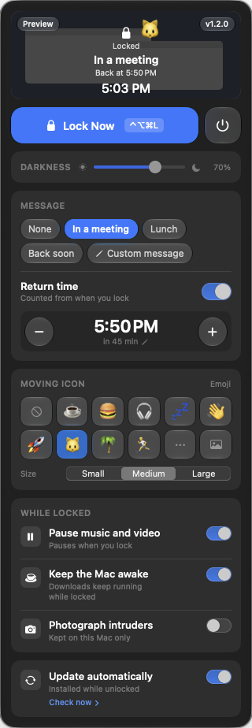

# 🛡️ Leave My Mac Alone

> Keep your Mac working while you step away — but stop anyone from touching the keyboard or mouse.


[](https://github.com/albooren/leaveMyMacAlone/releases/latest)


You start a long download, a video export or a big upload — and then you need to
step away. Leave My Mac Alone puts a dark "do not touch" screen over your Mac,
blocks the keyboard and mouse, and lets **your work keep running underneath**.
When you're back, unlock it with **Touch ID or your password**.

**[⬇️ Download the latest version](https://github.com/albooren/leaveMyMacAlone/releases/latest)** · free · macOS 14 or newer

## 🤔 Why not just use the Mac's own lock screen?

The built-in lock is great for security, but it's not made for "I'm away, but my Mac is busy":

| | Mac's own lock | Leave My Mac Alone |
|---|---|---|
| Your screen | Hidden | Still visible behind an adjustable dark layer — you can see your progress |
| Going to sleep | The Mac can go to sleep after a while, which pauses downloads and exports | Keeps the Mac awake while locked (you can turn this off) |
| Tell people where you are | — | "In a meeting · Back at 2:50 PM" right on the screen |
| Getting back in | Password / Touch ID | Password / Touch ID |

## ✨ What it does

- 🔒 **Lock in one click** — from the menu bar, or press **Control + Option + Command + L**.
- 🙅 **Nobody can use your Mac** — typing and clicking do nothing while it's locked.
- 👆 **Only you can unlock it** — with Touch ID or your Mac password.
- ⏳ **Your work keeps going** — downloads, exports and uploads run on while you're away.
- 💬 **Leave a note** — "In a meeting", "At lunch", "Back soon" or your own words, plus when you'll be back.
- 🌗 **Choose how dark** — from a light tint to fully black.

<details>
<summary><b>All features</b></summary>

- 📀 **Moving icon** — any emoji (searchable) or your own picture floats across the lock screen, like the old DVD screensaver.
- 👀 **Live preview** — the menu shows a mini lock screen with your darkness, message and icon as you change them.
- ⏸️ **Pauses music and video** when you lock, so nothing keeps playing at an empty desk (they don't restart by themselves). Want music to keep going? Turn off "Pause music and video".
- ☕ **Stays awake** while locked (optional).
- 📸 **Intruder photo** *(off by default)* — if someone keeps trying to get in, it takes a photo with the front camera and saves it to the `Pictures/LeaveMyMacAlone` folder on your Mac. You get a notification when you unlock.
- 🖥️ **Works over full-screen apps** — if you lock from a full-screen app (Slack, Safari, a video), it steps out of full screen so the lock covers everything.
- 🔄 **Updates itself** — new versions download quietly and install with a quick restart of the app, never while the Mac is locked. You can turn this off in the menu.
- 🌍 English and Turkish (follows your Mac's language).

</details>

<p align="center">
  
</p>

## 📦 Install

1. **[Download `LeaveMyMacAlone.dmg`](https://github.com/albooren/leaveMyMacAlone/releases/latest)**, open it and drag the app into **Applications**.
2. Open the app. A small **shield icon** appears at the top right of your screen, in the menu bar. (There's no window and no Dock icon — that's normal.)
3. Click the shield → **Lock Now**. The first time, your Mac asks for **Accessibility** permission:
   click **Open Accessibility Settings**, turn on **LeaveMyMacAlone**, and it locks right away.

> **Why Accessibility?** It's the macOS permission that lets an app block the keyboard and mouse.
> The app uses it only for that — it doesn't read what you type and sends nothing anywhere.

## 🎛️ How to use it

| To… | Do this |
|---|---|
| **Lock** | Click the shield in the menu bar → **Lock Now**, or press **Control + Option + Command + L** |
| **Unlock** | Click **Unlock** (or press Space / Enter), then use Touch ID or your password |
| **Change how dark it is** | Shield menu → **Darkness** slider |
| **Leave a message** | Shield menu → **Message** → pick one or write your own. Turn on **Return time** to show when you'll be back |
| **Add a moving icon** | Shield menu → **Moving icon** → pick an emoji, ⋯ to search all emoji, or 🖼 for your own picture |
| **Change what happens while locked** | Shield menu → **While locked** switches (pause music, keep awake, intruder photo, auto-update) |
| **Quit** | Shield menu → power button |

## ⚠️ Good to know

- **Closing a laptop's lid still puts it to sleep.** Keep the lid open (or use an external display and power).
- **Holding the power button** always turns the Mac off — no app can block that.
- It's meant to stop a curious co-worker or a cat on the keyboard, **not** to replace your Mac's real security.
  For real security, also use your Mac's own lock and FileVault.
- Some **games** use their own kind of full screen that the app can't step out of; the lock may end up behind them.
- When intruder photo is on, the **green camera light turns on** — that's built into the hardware, so it's a deterrent, not a hidden camera.
- It's downloaded from here rather than the Mac App Store (blocking the keyboard and mouse needs permissions App Store apps can't have).
  It's signed and checked by Apple (Developer ID + notarization), so it opens normally.

## 🔐 Privacy

- **No tracking, no accounts, no data collection.**
- The only thing it fetches from the internet is the update check (once a day, from this GitHub page). Nothing about you or your Mac is sent.
  Turn off **Update automatically** and it never goes online unless you press **Check now**.
- Intruder photos stay on your Mac only, in `Pictures/LeaveMyMacAlone`. They are never uploaded.

## 🆘 Advanced: if the lock ever gets stuck

Normally, **Unlock → Touch ID / password** is all you need. If the app ever freezes and won't
unlock, you can close it **from your iPhone or another computer** — your open apps and work keep
running (unlike forcing a restart).

<details>
<summary><b>Set this up once, before you need it</b></summary>

**On the Mac:** System Settings → General → Sharing → turn on **Remote Login**.

**One tap from iPhone (Shortcuts app):**
1. Create a new shortcut → add the **"Run Script Over SSH"** action.
2. Fill in:
   - **Host:** your Mac's IP address (e.g. `192.168.1.x`) or its local name (`<computer-name>.local`)
   - **Port:** `22`
   - **User:** your Mac username
   - **Authentication:** Password → your Mac login password (or an SSH key)
   - **Script:** `killall LeaveMyMacAlone`
3. Name it "Unlock Mac" and add it to your Home Screen, Action Button or Siri.

If the Mac gets stuck, tap the shortcut (iPhone and Mac on the same Wi-Fi) — the lock closes and the Mac is back.

**From another computer's Terminal:**
```bash
ssh <user>@<mac-ip> 'killall LeaveMyMacAlone'
```

> **Tips:** the IP address can change — reserve it on your router or use the `.local` name.
> To reach the Mac away from home, a free VPN like **Tailscale** works.
> **Last resort:** holding the power button restarts the Mac, but unsaved work is lost.

</details>

## 🛠️ For developers

```bash
swift build && swift test     # build + tests (68 tests)
./bundle.sh                   # local .app (self-signed dev identity)
```
Create a one-time `LeaveMyMacAlone Dev` code-signing certificate (`bundle.sh` finds
it automatically) and the Accessibility grant survives rebuilds.

How it works: LocalAuthentication for Touch ID/password, a CoreGraphics event tap to block
input, IOKit to keep the Mac awake, and [Sparkle](https://sparkle-project.org) for
EdDSA-signed updates. It's non-sandboxed, so it ships as a Developer ID–signed, notarized download.

The demo GIF is a [HyperFrames](https://hyperframes.heygen.com) composition in
[`docs/readme-demo`](docs/readme-demo) — edit `index.html` and re-render to update it.

## 📄 License
[MIT](LICENSE) © 2026 Alperen Kişi
